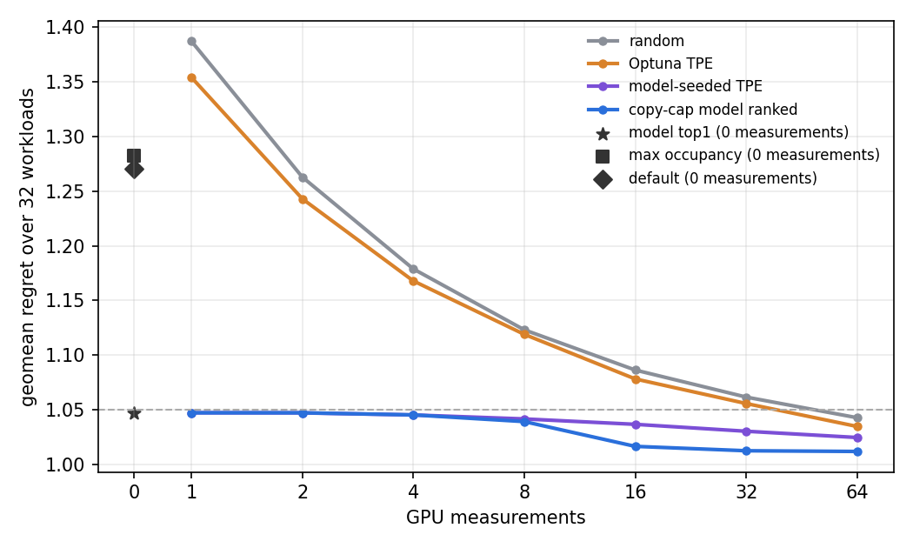
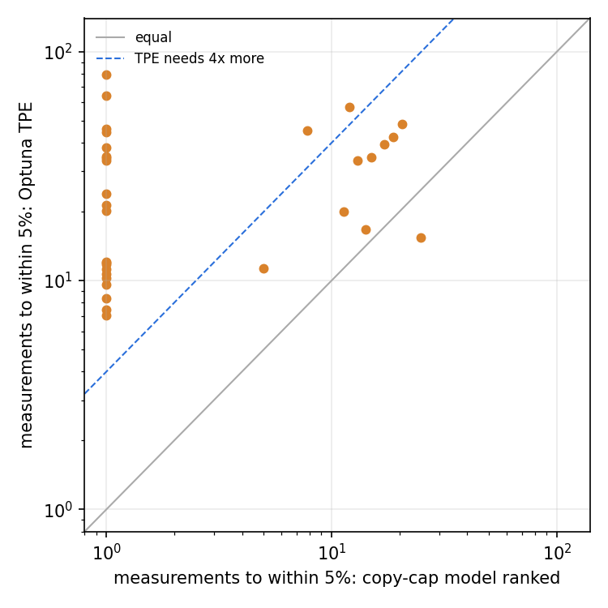

# Budgeted autotuning benchmark: copy-cap model vs Optuna TPE

**Question.** Does the existing copy-cap hardware cost model (`lab/gemm_model.py`, unchanged) find a GEMM tile within 5% of the best measured tile using at least 4x fewer GPU measurements than Optuna TPE, on workloads it never saw?

**Verdict: SUPPORTED on the pre-registered primary metric, with two important qualifications.**

- **Measurements.** Geomean measurements-to-within-5% are 2.44 for the model and 22.57 for TPE. That gives E = **9.26x, 95% bootstrap CI [5.96, 14.09]**. The CI lower bound is above 4.
- **Qualification 1: the win is not uniform.** E < 4 on 9 of 32 workloads. On one of them (gemma-2-9b/o/P1024) TPE is faster.
- **Qualification 2: wall-clock.** Building and predicting all 212 candidates costs about 230 s of CPU per workload (114 s amortized). TPE reaches 5% in about 26 s of GPU and build time. If nothing is cached, the model loses on end-to-end wall-clock. It wins only on GPU measurements, which is what was asked.

Protocol: `data/autotune_bench/PROTOCOL.md`, frozen in commit d831ac3 before any GPU timing. Seeds and the simulator are in addendum 1 (15df939), also committed before any results. Raw data: `data/autotune_bench/raw/round{0,1,2}.json`, `check.json`, `preds.json`. Analysis: `data/autotune_bench/results.txt` and `sim.json`.

## Setup

| | |
|---|---|
| Workloads | 32 = 4 families (Qwen2.5-7B, Gemma-2-9B, Phi-3-mini, Qwen2.5-14B) x 4 layers (qkv, o, gate-up, down) x 2 prefill lengths (P=256, 1024) |
| Candidates | 212 compiled tiles per workload, from the existing `rank_fresh` generator (357 generated, 212 build, all valid for every shape) |
| Model | copy-cap model, `CP_QUEUE=None`, predictions written to `preds.json` with its sha256 before timing. No refit. |
| Correctness | every (workload, tile) checked against an fp32 reference computed from correctly quantized activations (Q8 kernel), rel. tol 1e-2. **0 failures of 6,784.** |
| Timing | 3 independent rounds. Each round times all 6,816 (workload, tile) pairs plus A/A twins in a fresh random order (seed 1000+round), via `pcslurm` on one RTX 3080, 20 reps each with a synced warm-up. |
| Truth | best = min over tiles of the median across 3 rounds. A tuner sees one randomly chosen round per measurement, so it pays for noise. |
| Strategies | random search, max-occupancy heuristic (k=0), shipped default (k=0), model-ranked (measure in model order), Optuna TPE, TPE seeded with the model's top 4 |
| Budgets | 0, 1, 2, 4, 8, 16, 32, 64. Stochastic strategies use 32 seeds per workload. |

## Results



Geomean regret over 32 workloads (95% bootstrap CI over workloads):

| k | model-ranked | model-seeded TPE | TPE | random |
|---|---|---|---|---|
| 0 | 1.047 [1.028, 1.071] (top-1) | | default 1.270, max-occupancy 1.282 | |
| 1 | 1.047 | 1.047 | 1.354 | 1.387 |
| 2 | 1.047 | 1.047 | 1.243 | 1.263 |
| 4 | 1.045 | 1.045 | 1.168 | 1.179 |
| 8 | 1.039 | 1.042 | 1.119 | 1.123 |
| 16 | 1.017 | 1.037 | 1.078 | 1.086 |
| 32 | 1.013 | 1.030 | 1.056 | 1.062 |
| 64 | 1.012 [1.009, 1.016] | 1.025 | 1.035 [1.028, 1.042] | 1.043 |

Measurements to within 5% of the best tile (geomean; runs censored at 64 counted as 128):

| strategy | m5 | censored runs | ratio vs model |
|---|---|---|---|
| model-ranked | 2.44 | 2.3% | 1 |
| model-seeded TPE | 3.37 | 11.4% | |
| TPE | 22.57 | 21.9% | **9.26 [5.96, 14.09]** |
| random | 27.06 | 28.6% | 11.10 [7.21, 16.82] |

The censoring choice doesn't drive the result. Counting censored runs as 65 instead gives model 2.40 and TPE 19.46, still about 8x. TPE itself beats random by only 1.20x [1.11, 1.29]. In a 212-point space with 7 categorical knobs, 64 trials is too few for TPE's density model to separate from random by much.



**The ratio holds in every subgroup.** E by family is 14.3, 8.2, 7.1 and 8.9. By layer: qkv 10.1, o 5.1, gate-up 6.9, down 20.5. By length: P256 6.6, P1024 13.0. The "o" projection and P=256 are the weakest groups.

## Where the 4x target fails

The per-workload picture is bimodal (scatter above).

- **21 of 32 workloads:** the model's first pick is already within 5% (m5 = 1).
- **11 workloads:** the model needs 5 to 25 measurements.
- **9 workloads with E < 4:**

| workload | m5 model | m5 TPE | E |
|---|---|---|---|
| gemma-2-9b/o/P1024 | 24.8 | 15.4 | **0.62** |
| phi-3-mini/gu/P256 | 14.1 | 16.7 | 1.18 |
| qwen2.5-14b/qkv/P256 | 11.3 | 20.1 | 1.77 |
| phi-3-mini/qkv/P256 | 5.0 | 11.3 | 2.26 |
| gemma-2-9b/gu/P1024 | 18.8 | 42.5 | 2.26 |
| phi-3-mini/o/P1024 | 17.1 | 39.3 | 2.30 |
| qwen2.5-14b/down/P256 | 15.0 | 34.5 | 2.30 |
| qwen2.5-14b/o/P256 | 20.6 | 48.1 | 2.33 |
| qwen2.5-7b/o/P1024 | 13.0 | 33.4 | 2.57 |

**Why it fails there:** one tile, warp layout (4,2,4,2) with KB=4, NSTG=2, MINB=2, is the measured best on 14 of 32 workloads. On 12 of those 14 the model ranks it exactly **12th**. So the model's ordering near the top barely depends on the shape: it consistently overrates the 11 tiles above this one.

- When the best tile is that one and few other tiles are within 5%, model-ranked search has to walk through those 11 before reaching it. That accounts for the m5 values of 12 to 25.
- On the 21 easy workloads, either a top-ranked tile is genuinely best, or several tiles are within 5%, so the first pick is close enough.

In other words, the model has a good coarse prior: it separates the top 15 from the bottom 200, with Spearman 0.61 to 0.86 per workload. It does not have shape-specific resolution among the top dozen. Fixing this would mean refitting the model on these workloads, which the protocol forbids. It is documented here as the model's main miss, not corrected.

## Wall-clock cost

Median wall-clock to reach within 5%, counting measurement and compile time only:

| strategy | time |
|---|---|
| model-ranked | 1.6 s |
| model-seeded TPE | 1.6 s |
| TPE | 26.1 s |
| random | 27.6 s |

**Model overhead is the negative result.**

- To rank, the model needs register and shared-memory counts for every candidate, so it compiles all 212 tiles plus prediction. That is about 230 s of CPU per workload, or 114 s amortized when one compile serves all 32 shapes.
- TPE's sampler costs about 11.5 s per 64-trial run.
- So end to end, from a cold start, the model is slower than TPE. It only pays off when the compiled-tile metadata is cached and reused across many shapes, or when GPU time is the scarce resource, for example on a shared, queued GPU like this one.

The goal asked about GPU measurements, and on that metric it is a clear win. On wall-clock from a cold start it is not.

## Noise and controls

- **A/A** (the default tile timed against an identical recompiled twin, interleaved): median |log ratio| is 1.30%, and the maximum is **10.5%**.
- The best tile's time also moves between rounds: the median ratio of the slowest to the fastest round is 1.07.
- Measurement noise is therefore not small compared with the 5% threshold. This is why tuners see a single noisy round rather than the median, and why "within 5%" occasionally flickers.
- This noise affects every strategy equally, and the ranking held at every budget.

## Deviations and negatives (complete list)

1. **Addendum 2: harness warm-up fix.**
   - The existing `batched_gemv_bench.timeit` queued unsynchronized graph replays during warm-up. That amounted to about 16 s of GPU work per measurement, which made job 2243 infeasible.
   - Job 2243 was cancelled. Its artifacts are kept in `data/autotune_bench/job2243_cancelled/`.
   - The fix (synchronize during warm-up) was committed as addendum 2 before any timing used for results. Timing semantics are otherwise unchanged.
2. **Plotting bug:** `plots()` indexed JSON budget keys as ints, and after the save they are strings. Fixed after the results. It affects plotting only, not any number.
3. All 212 compiled tiles happened to be valid for every shape. The frozen spaces are therefore identical across workloads: 212 candidates each, above the 200 target.
4. TPE is barely better than random here (1.20x). The comparison is against a fair, standard TPE configuration (categorical knobs, invalid proposals told FAIL, duplicates told the cached value), but a different search-space encoding might help TPE. It was not tuned, per the protocol.
5. Model-seeded TPE is worse than plain model-ranked at every budget of 8 or more. After the seeds, TPE abandons the model's ordering. Seeding helps TPE 6.7x, but does not beat just trusting the ranking.

## Reproduce

```
pcslurm submit --name autotune-predict -- python scripts/autotune_bench.py predict   # already frozen; regenerates preds.json
pcslurm submit --name autotune-measure -- python scripts/autotune_bench.py measure   # ~4.9 h on an RTX 3080
python scripts/autotune_sim.py          # ~35 min CPU (needs optuna)
python scripts/autotune_sim.py plots
```
